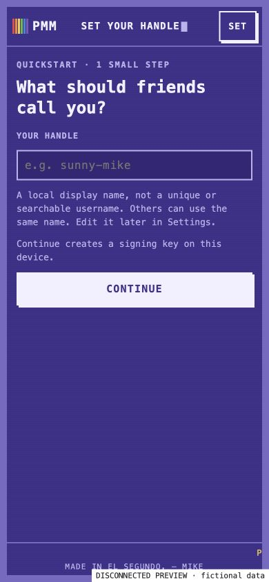
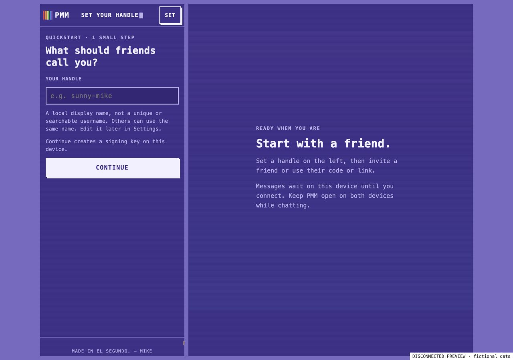

# PMM: quickstart and conversation clarity

Visual review and disconnected verification, 23 October 2026. Baseline: `39fb30497bb08c286c8cfbb41a46d61ad1030569` (Mood Atlas merged). Chrome on macOS at 390 × 844, 320 × 640, and 1280 × 900.

## Design assessment

The C64 purple palette, pixel sigils, rainbow message borders, and left/right sender alignment give PMM a recognizable identity. The retro style works best when decoration supports a plain-language action.

The original lobby asks newcomers to understand `LOAD "FRIEND",8,1`, while the desktop's large `READY.` pane does not explain what to do. A handle can be overlooked in Settings. The phone chat truncates its connection description; checkmarks suggest a read receipt although the implementation only acknowledges receipt. Existing sound defaults do not establish explicit audio consent.

This change puts a short handle step in front of chat actions, then offers **Invite a friend** or **Use a code or link**. It keeps the terminal personality while spelling out what a connection and delivery label actually mean. The handle is a local display name, with no uniqueness, search, or identity guarantee. Duplicate names are allowed; the existing sigil remains separate. Existing saved names and identities are retained, and handles can be edited in Settings.

## Before and after

All screenshots use fictional data and a disconnected renderer. They are not evidence of a successful live connection or delivery. The preview blocks transport, credentials, audio, service workers, and consequential controls; its Continue action uses an inert identity stub. The production code's intentional identity action is tested without generating a key.

| Screen | Before | After |
| --- | --- | --- |
| Phone front door, 390 × 844 | [Original lobby](2026-10-23-pmm-quickstart/before-phone-lobby.jpg) | [Quickstart](2026-10-23-pmm-quickstart/after-phone-quickstart.jpg), [ready to invite](2026-10-23-pmm-quickstart/after-phone-lobby.jpg), [paste an invite](2026-10-23-pmm-quickstart/after-phone-join.jpg) |
| Phone conversation, 390 × 844 | [Original conversation](2026-10-23-pmm-quickstart/before-phone-conversation.jpg) | [Clear connection and delivery labels](2026-10-23-pmm-quickstart/after-phone-conversation.jpg) |
| Small phone, 320 × 640 | — | [Expanded delivery guide](2026-10-23-pmm-quickstart/after-small-phone-conversation.jpg) |
| Desktop, 1280 × 900 | [Original lobby](2026-10-23-pmm-quickstart/before-desktop-lobby.jpg) | [Quickstart and next-step explanation](2026-10-23-pmm-quickstart/after-desktop-quickstart.jpg) |

## Behavior and validation

- A fresh session renders setup without generating an identity or starting connection services. Continue validates the name and intentionally creates the existing device signing identity. Returning profiles import their existing identity and skip setup. Saved invites survive setup, validation errors, retry, and the skip link.
- Handles normalize whitespace and an optional leading `@`, allow 1–24 characters, reject unsuitable new values, allow duplicate display names, and preserve unchanged legacy names. Repeated Continue clicks cannot create parallel identities.
- The first conversation explains where to write. Disconnected text stays **Waiting** on this device; **Sent** means submitted over the connection; **Received** means acknowledged by the friend's PMM, not read by the person. The composer says **Keep here** while disconnected.
- Sound requires a deliberate Settings checkbox change saved with Done, plus a browser gesture. Legacy `sound: true` does not establish consent. The existing reduced-motion rule remains in place. Common controls have 44px touch targets; the delivery guide remains scrollable without displacing the composer at 320px width.
- `npm run test:pmm`: **132 passed, 0 failed**, including 20 new behavior tests for onboarding, receipt wording, connection controls, and sound consent. Tests deny unintended network and crypto calls and use inert identity/transport seams. Dependencies were reused from an existing local install; no dependency versions changed.
- The four app/service-worker JavaScript syntax checks pass, as does `git diff --check`. The PMM service-worker digest was regenerated. No Astro build is needed for these static files, matching the dedicated PMM workflow.
- Independent review found no blocking issue after fixes for Settings completion of a nameless returning profile, first-message guidance after a system event, and skip-link handling of invite hashes.

## Limits and integration notes

No live two-device connection, real credential creation, real messaging, room join, microphone capture, payment, production deployment, or merge was performed. Browser captures validate layout and the disconnected UI only. Actual phone keyboard behavior, assistive-technology traversal, reduced-motion emulation, and live transport still need a separate device acceptance pass.

The existing Settings/dialog focus trapping and focus restoration remain incomplete. The screens retain a dense retro font; larger text and a broader contrast audit remain worthwhile. This is a focused usability improvement, not a claim of complete accessibility or secure/private/encrypted delivery.

The branch includes merged branding/sigils (#1532) and Mood Atlas (#1533), and does not implement the open sound/haptics lab (#1535), animated emote lab (#1536), rooms (#1528), Stretch breaks (#1534), or Tezos settle work (#1526). Rooms and settle touch the same core files, so their later integration may need conflict resolution and a new cache digest. Latest main was checked before PR preparation; intervening main changes did not touch PMM.
