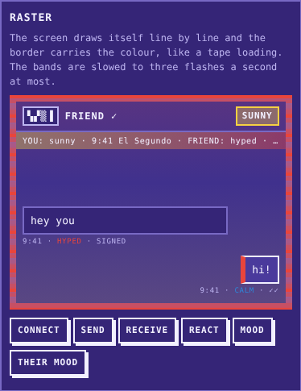
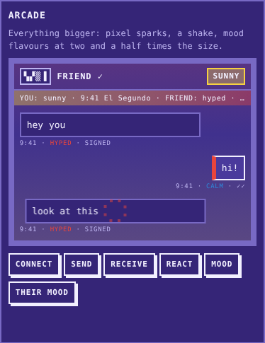
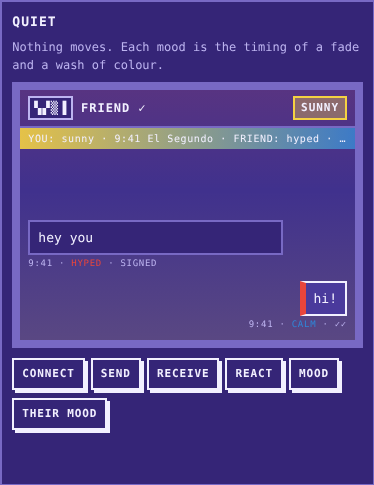
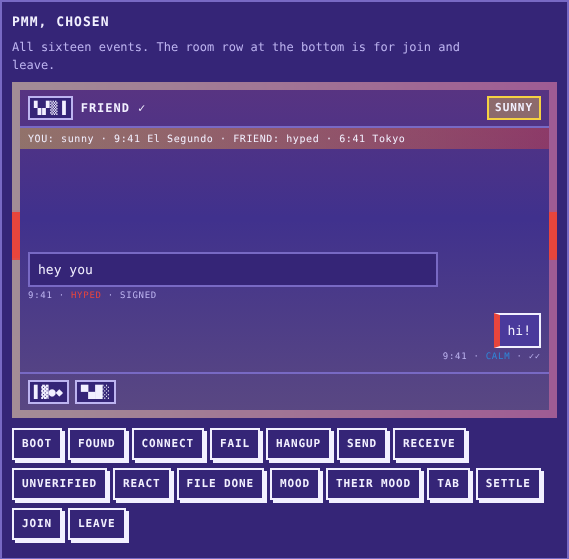
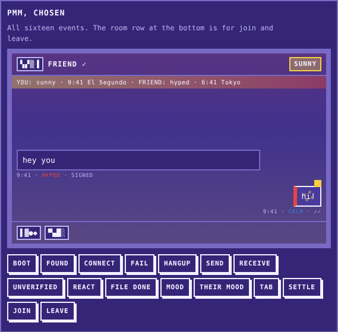
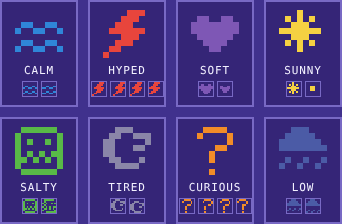

# PMM motion sprint: emotion and motion

**Date:** 2026-10-23. **Ran by:** Claude Code, motion thread of the PMM design sprints.
**Source:** Mike asked for two design-sprint threads, "make super neat emotions, animations, audio". This thread owns emotion and motion. A sibling thread owns sound and haptics (`/pmm/sound/`, branch `cc/pmm-sound-20261023`).
**Lab:** [`/pmm/motion/`](../../public/pmm/motion/index.html). **Module:** `public/pmm/motion/motion.js`. **Tests:** `tests/pmm-motion.test.mjs`.
**Phase:** 1 of 2. Nothing in the app changes yet. Phase 2 wires it in after Rooms (#1528), Settle (#1526), Brand (#1532) and Moods (#1533) merge.

## 1. Map: every emotional moment in PMM

The event names are shared with the sound sprint, so one call can drive a motion and a sound together. The durations are the canonical table, which both sprints use unchanged.

| Event | ms | The moment | What it should feel like |
|---|---|---|---|
| `boot` | 1200 | The app opens on READY. | The machine waking. |
| `found` | 600 | The handshake finds the other phone. | A sigil appearing: someone's there. |
| `connect` | 900 | The line opens and the signed hello lands. | The tape has loaded. Their mood comes into the room. |
| `fail` | 500 | `?DEVICE NOT PRESENT ERROR` and the other errors. | A shrug, not a crash. The text says what to do. |
| `hangup` | 400 | LINE DROPPED. | A set switching off. |
| `send` | 180 | My message leaves. | Quick. I already know what I said. |
| `receive` | 240 | Their message lands. | The most frequent moment, and the one their mood shapes most. |
| `unverified` | 400 | A message whose signature fails. | Something's off. Quiet, but noticeable. |
| `react` | 300 | Long press, pick a reaction. | A small pop that stays. |
| `file-done` | 400 | A photo or file finishes arriving. | Settled, complete. |
| `mood` | 600 | I change my mood. | My chip becomes the new mood. |
| `their-mood` | 600 | They change theirs. | The room's weather changes from their side. |
| `tab` | 300 | A TAB line lands. | A stamp on a receipt. |
| `settle` | 900 | The tab is settled. | The one moment the rainbow is allowed to move. |
| `join` | 400 | Someone joins a room (#1528). | A sigil slides into the row. |
| `leave` | 300 | Someone leaves a room. | It steps out and dims. |

The mood moments come in two kinds:

- **Moods meeting:** `connect` and `their-mood`. Two colours make an atmosphere, as the atmosphere line and the chat pane's gradient already do.
- **Mood flavouring:** `send` and `receive`. One person's mood decides how a message moves.

## 2. Three directions

All three live side by side in the lab, sharing one mood picker. Each covers `connect`, `send`, `receive`, `react`, `mood` and `their-mood`. In each, the sender's mood flavours the entrance. Screenshots were taken mid-animation in headless Chromium at 1280px, with me set to sunny and them to hyped.

### Raster



- **Idea:** a C64 tape loading. The border carries colour in scrolling raster bands, and bubbles draw themselves line by line (scaleY in steps).
- **Mood:** each mood is a band colour and a number of lines per frame. Hyped draws in two lines, tired in eight.
- **Strong:** the most recognisable 8-bit gesture there is, and it uses the border, which the brand already owns.
- **Weak:** real loader bars flicker at tens of hertz, which is a seizure risk. Ours have to be governed down to three flashes a second (see §4). Bright moods like sunny then scroll at 53 to 68 px/s, which reads more as a slow barber pole than a loader. A continuous canvas also costs the most battery of the three. Drawing a bubble line by line hides its words for most of its 240 ms.

### Arcade



- **Idea:** juice. Pixel sparks, screen shake, and mood flavours at 2.5 times the size.
- **Strong:** the most delight per tap, and moods are unmistakable.
- **Weak:** at 390px a 2.5x jitter moves a bubble most of a character width, and a shake on every `their-mood` gets tiring by the tenth message. It has no honest reduced-motion story, because its meaning is the movement. The brand book says "Short. Dry." and this is neither.

### Quiet



- **Idea:** nothing moves. Mood is carried by the easing of a fade and a wash of colour. Tired fades in late on a slow curve. Hyped snaps in two steps. Curious overshoots its curve.
- **Strong:**
  - Legible at any size.
  - Cheapest: opacity only, so it stays on the compositor.
  - Its reduced-motion version is almost itself.
- **Weak:** easing differences are subtle on a phone. Most people won't feel "tired" from a curve alone. Smooth easing also goes against the brand book's "Motion is stepped, not eased".
- **A bug it exposed:** in the first build the wash sat over the text and hid the atmosphere line mid-fade. Fill tints now render under the element's content (z-index -1 inside an isolated element), in every direction.

## 3. Decision

Scores are 1 to 5, with 5 best. "Battery, frames" comes from the frame timings in §5 and from what each direction keeps running.

| Direction | Delight | Legible at 390px | Battery, frames | Reduced story | Brand fit | Total |
|---|---|---|---|---|---|---|
| Raster | 4 | 3 | 2 | 3 | 4 | 16 |
| Arcade | 5 | 2 | 3 | 2 | 2 | 14 |
| Quiet | 2 | 5 | 5 | 5 | 3 | 20 |
| **Chosen: graft** | **4** | **5** | **4** | **5** | **5** | **23** |

Quiet wins on its own, but it is too polite for "super neat". The chosen system is a graft with Quiet as the base, which keeps its legibility, cost and reduced-motion story. To that base it adds three things:

1. **The brand book's stepped motion** for each mood's entrance: three to six steps, short paths of 3 to 10 px. Each mood gets a small path of its own, taken from the brief's suggestions:
   - hyped jitters
   - soft floats
   - sunny sparkles
   - salty glitches
   - tired arrives late and drops
   - curious tilts
   - low sinks
   - calm eases

   Send uses my mood at 60% of the size, because I already know what I said. Receive uses theirs at full size.
2. **Raster's tape border, only where a line opens.** `boot` uses governed bands in my mood. `connect` is one band in their mood sweeping down the border, once.
3. **Arcade's pixel sparks, only where they mean something:** a reaction, a sunny arrival, a found sigil. Arcade's shake survives only on `fail` and `unverified`, the two moments that should feel wrong.

Left out:

- Raster's line-by-line bubbles, because they hide the words.
- Arcade's shake on everyday moments, and its 2.5x flavours.
- Quiet's smooth curves outside reduced motion.




### Animated emotes



- **Source:** each Mood Atlas 8×8 glyph (#1533) becomes a two to four frame loop at 6 fps. The frames are small pixel moves of the glyph itself, so if a glyph changes in `moods.js`, its animation follows:

  | Mood | Frames | What moves |
  |---|---|---|
  | calm | 2 | the waves drift |
  | hyped | 4 | the bolt buzzes |
  | soft | 2 | the heart beats (an erosion of the glyph) |
  | sunny | 2 | the rays twinkle (its core alone) |
  | salty | 2 | every other line glitches |
  | tired | 2 | a slow nod |
  | curious | 4 | the question tilts |
  | low | 2 | the rain falls |

- **Use:** they are the reactions. `react` pops the emote above the bubble, where it stays. `loopEmote()` runs a badge on a timer at its own frame rate rather than a 60 Hz loop, and skips frames while the page is hidden.

## 4. Spec

Every motion uses `transform` and `opacity` only, with colour carried by a mood-coloured layer whose opacity moves. There is at most one canvas for the border and one 8×8 canvas per emote. Nothing animates while `document.hidden`: `play()` is a no-op then, and a hidden page finishes the running animation at once.

**Flash rule (WCAG 2.3.1).** `plan()` counts flashes itself. A flash is a pair of opposing luminance changes of 0.1 or more, and the count is taken over the worst one-second window:

- Opacity stands in for luminance on ordinary layers, which overstates them.
- The tape border uses its bands' real luminance against the border colour.
- A governor slows the bands until they flash three times a second or less.

The test runs this check for 4 directions × 16 events × 8 × 8 mood pairs × reduced on and off: 8,192 plans. No plan goes over 3. With reduced motion on, every plan counts 0.

**Reduced motion is an alternative, not off.** Its rules:

- No transforms, no sparks and no border bands. Emotes hold their first frame.
- Colour changes are crossfades from the previous state.
- Error states fade in and hold.
- Entrances keep their mood's timing: tired still arrives late, hyped still snaps in.

| Event | On | ms | Motion | Reduced motion | Worst flashes |
|---|---|---|---|---|---|
| `boot` | screen | 1200 | Tape bands in my mood scroll round the screen edge, governed to ≤ 3 flashes/s | The screen crossfades up from the dark field, 4 steps | 3 for sunny, salty and curious (governed); 0 for the rest |
| `found` | sigil | 600 | Pops from 0.4 to 1.15 to 1 in 3 steps, plus 4 green sparks | Fades in, 3 steps | 1 |
| `connect` | screen | 900 | One band in their mood sweeps down the border once; both moods wash the border and fade | The empty screen crossfades to the two-mood atmosphere, 6 steps | 1 to 2 |
| `fail` | screen | 500 | A 4-step shake (±4px), then a red outline that holds until cleared | The red outline fades in and holds; the `?ERROR` text carries it | 0 |
| `hangup` | screen | 400 | The screen closes to a line (scaleY 0.04) and reopens, 4 steps | The green online edge fades out; the LINE DROPPED toast carries it | 0 |
| `send` | bubble | 180 | My mood's entrance at 60% size | Fades in with my mood's timing | 0 |
| `receive` | bubble | 240 | Their mood's entrance at full size (sunny adds 4 sparks) | Fades in with their mood's timing | 0 to 1 |
| `unverified` | bubble | 400 | A 3-step twitch, then a red outline that holds | The red outline fades in and holds; UNVERIFIED in the meta line | 0 |
| `react` | bubble | 300 | The emote pops 0 to 1.3 to 1 in 4 steps and plays its frames, plus 4 sparks; it stays | The emote fades in on its first frame and stays still | 1 |
| `file-done` | bubble | 400 | Settles from a 1.06 swell; a green wash fades | Fades in | 1 |
| `mood` | chip | 600 | The chip swells and settles while the new mood's emote plays on it | The old colour crossfades to the new, 6 steps | 2 |
| `their-mood` | atmo | 600 | Their colour wipes across from their side (scaleX, 6 steps), then fades into the line | The old atmosphere crossfades to the new, 6 steps | 1 |
| `tab` | bubble | 300 | Lands like a stamp: rotated −4°, scale 1.25 to 1, 3 steps | Fades in, 2 steps | 0 |
| `settle` | bubble | 900 | The six stripes slide across once in 9 steps, then a stripe stays on the left edge | The edge stripe fades in and stays | 1 |
| `join` | row | 400 | Slides in from −12px, 4 steps | Fades in, 4 steps | 0 |
| `leave` | row | 300 | Steps 8px right and dims to 0.4 (holds; remove it after the promise) | Dims to 0.4 | 0 |

**API.**

| Call | What it does |
|---|---|
| `plan(event, { mood, theirMood, was, reduced, direction })` | Pure. Returns `{ event, on, duration, layers, flashes }`. `was` is the mood before a `mood` or `their-mood` change. |
| `play(event, el, opts)` | Returns a Promise of the plan, or `null` when the page is hidden or there is no DOM. |
| `clear(el, event?)` | Removes layers that were kept (outlines, emotes, stripes). |
| `emoteFrames(mood)`, `drawGlyph()`, `loopEmote()` | Emote frames, drawing, and a looping badge. |
| `EVENTS`, `DURATION_MS`, `TARGET` | The event list, the shared timings, and what each event animates. |

- **Size:** `motion.js` is under 20 KB of source and imports nothing but the moods module. The three sketches are in `sketches.js`, which only the lab loads.
- **TEMP:** until #1533 merges, `motion.js` imports `./moods.temp.js`, a verbatim copy of `public/pmm/moods/moods.js` from that branch (5bbc2a89). After the merge the import becomes `../moods/moods.js` and the copy is deleted. That is a one-line change in each of `motion.js`, `sketches.js`, the lab and the test.

## 5. Verification

Run in this cloud session:

- **Headless Chromium** (playwright-core 1.x, `/opt/pw-browsers/chromium`) at 390×844, 1280×900, and 390×844 with `reducedMotion: 'reduce'`:
  - No horizontal scroll at any width (`scrollWidth === clientWidth`).
  - No console or page errors.
- **Frame timing:** rAF deltas over about 21 s with every event played on the chosen phone, and the six sketched events also played on all three sketch phones at the same time:

  | Run | Frames | p50 | p95 | p99 | max | > 33 ms |
  |---|---|---|---|---|---|---|
  | 390 | 1248 | 16.7 | 16.7 | 16.8 | 33.3 | 0 |
  | 1280 | 1249 | 16.7 | 16.8 | 16.8 | 16.8 | 0 |
  | 390, reduced | 1249 | 16.7 | 16.7 | 16.8 | 16.8 | 0 |
  | 390, CPU throttled 6× | 1250 | 16.7 | 16.8 | 16.8 | 100 | 3 |
  | 390, reduced, 6× | 1249 | 16.7 | 16.7 | 16.8 | 83 | 2 |

  The throttled spikes line up with the lab building new bubbles in the DOM, not with the animations. This is headless software rendering, so real-phone numbers still need Manus (see the brief).
- `npm run test:pmm`: 96 pass. `node --test tests/plates-batch.test.mjs`: pass.
- `npm run build:bare` was not run. The cloud session can't reach `api.tzkt.io`, so the build can't finish here. The lab is a static file under `public/` and touches no route, feed or layout.

## 6. Phase 2: integration plan

Phase 2 starts once the coordinator says #1526, #1528, #1532 and #1533 have merged. First, rebase onto main and switch the TEMP import. The line numbers below are against main at `54a56a73` and will move with those PRs, so match on the quoted code.

**Loading.** `app.js` is a classic script, so motion comes in lazily with a dynamic `import()`, which classic scripts allow. A failure leaves PMM exactly as it is today. Add this near `reduced` (line 52):

```js
// Motion loads after first paint and never blocks the app; if it fails, the CSS pop stays.
let motion = null;
const fx = (ev, el, o = {}) => motion ? motion.play(ev, el, { mood: state.me.mood, theirMood: current?.mood, reduced, ...o }) : Promise.resolve(null);
const loadMotion = () => import('./motion/motion.js').then((m) => { motion = m; }).catch(() => {});
if (window.requestIdleCallback) requestIdleCallback(loadMotion, { timeout: 2000 }); else setTimeout(loadMotion, 200);
```

**Hooks.** `renderChat()` rebuilds every bubble, so a bubble hook runs right after `renderChat()` and finds the bubble by `data-id`: ``$('messages').querySelector(`[data-id="${id}"] .bubble`)``.

| Event | Where in `app.js` | Element |
|---|---|---|
| `boot` | `boot()` line 764, after the first `renderMe()` | `.crt` |
| `found` | `screen()` line 271: when `l2 === 'FOUND'` | `#load-line2` |
| `fail` | `screen()` line 271: when `l2` starts with `?` | the load pane |
| `connect` | `onData` case `hello`, the `if (first)` branch (line ~509), after `renderAtmo()`. This is when the hello is verified, the friend's mood is known and the line is trusted. It is not dc `open`. | `.crt` |
| `hangup` | `closed()` in `wire()` line 453, next to `toast('LINE DROPPED')` | the chat pane |
| `send` | composer submit line 675, after `renderChat()` | the new message's bubble |
| `receive` | case `msg` line 520, after `renderChat()`; `theirMood: m.mood` | the new message's bubble |
| `unverified` | same as `receive` when `ok === false`; plays instead of `receive` | the new message's bubble |
| `react` | the `#reacts` click (line 703) and case `react` (line 524) | the reacted bubble |
| `file-done` | case `file-end` (line 551) and the end of `sendFile` (line 586) | the file bubble |
| `mood` | the mood button handler (line 181): `was` = the old `state.me.mood` | `#btn-mood` |
| `their-mood` | case `mood` (line 525): `was` = the old `f.mood` | `#atmo` |
| `tab` | `#form-tab` submit (line 715) and case `tab` (line 536) | the tab bubble |
| `settle` | case `settle` (line 539), plus the sender side once #1526 lands | the TAB SETTLED line |
| `join`, `leave` | the room member list from #1528; `await fx('leave', row)` before removing it | the member row |

Other phase-2 work:

- **CSS:** when `motion` is loaded, a hooked bubble gets `style.animation = 'none'`, so the CSS `pop` and the motion entrance don't stack. Unhooked bubbles keep `pop`. The global `prefers-reduced-motion` rule in `style.css` stays: `motion.js` reads the same media query and plays its alternatives through WAAPI, which that CSS rule does not block.
- **`sw.js`:** precache `/pmm/motion/motion.js`, so motion works offline. Bump `VERSION` and refresh `DIGEST`, per the offline tests.
- **Sound:** `fx(ev, …)` and the sound sprint's player take the same event names. Phase 2 can call both from one helper, so a moment's motion and sound start together.
- **Reactions:** emoji reactions stay, and the eight mood emotes are a second row in the reaction sheet (PM decision, §7). An emote goes over the wire as `r: 'mood:<id>'`, and the receiver accepts it only if `<id>` is in `MOOD_IDS`. That means widening the `str(m.r, 2)` cap in case `react`. The badge is a `loopEmote()` canvas, which holds its first frame under reduced motion.
- **Boot border:** it plays once per session. `sessionStorage` key `pmm/motion-booted`; if storage throws, it plays on every open. A tap calls `clear()` and skips the rest, and it never runs under reduced motion.

## 7. PM decisions

These came from the coordinator (acting PM) on 2026-10-23. Mike can overrule either one.

1. **Emotes and emoji.** Emoji reactions stay, and the eight mood emotes become a second reaction row. PMM isn't deployed yet, so there are no old clients to stay compatible with. An emote is sent as `r: 'mood:<id>'` and validated against `MOOD_IDS` on receipt. Under reduced motion it shows its first frame, held still.
2. **The boot tape border plays once per session.** It uses `sessionStorage`, and falls back to every open if storage throws. A tap skips it, and it never runs under reduced motion. Connect keeps its border sweep every time, because a verified line is always new.

Also decided: `connect` means the moment the hello is verified, not dc `open`. The sound sprint uses the same definition, and the hook table above follows it. The line numbers are against `54a56a73` and get re-checked against main at the phase-2 rebase.
