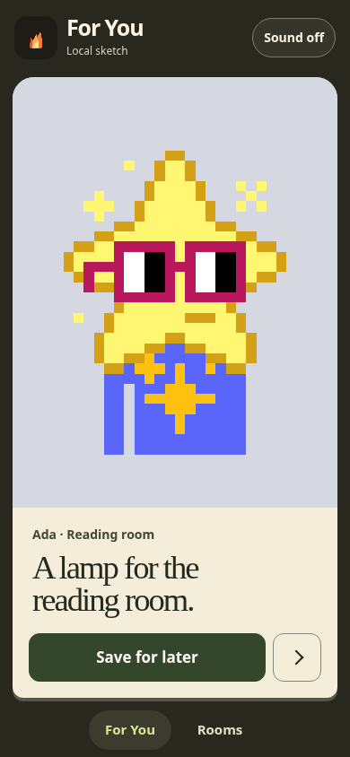
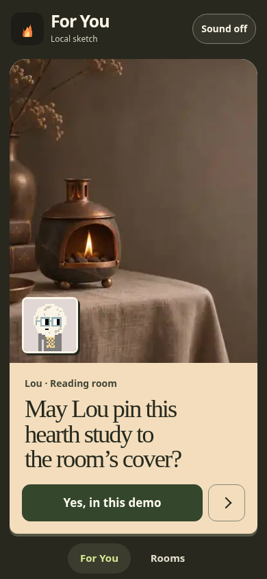
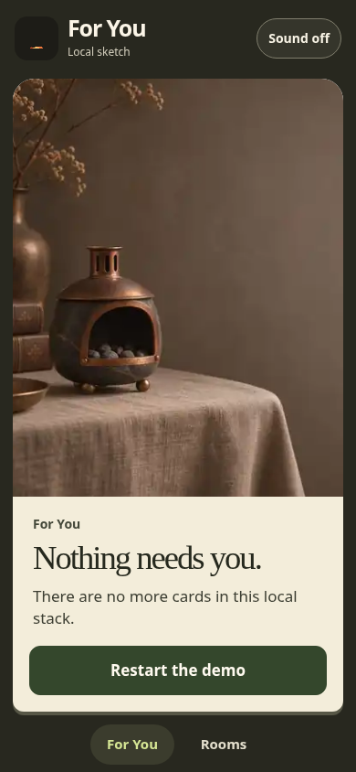
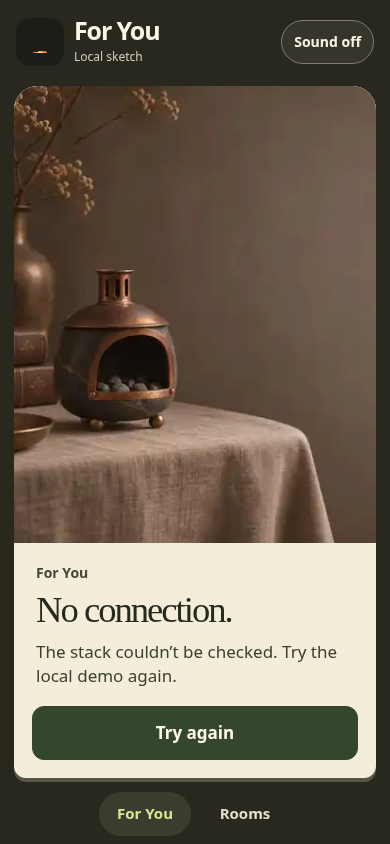

# For You card stack

The [standalone sketch](../../../public/sketches/loom-kit/cards/index.html) shows three fictional room messages. Save Ada’s study, review Lou’s request to pin the hearth image, or send a local thank-you to Tess. Swipe the card or tap the arrow to move on. The Rooms sheet jumps between the sample rooms. Save and thank-you actions offer Undo for five seconds. The demo reads one local JSON file and keeps card actions within that view.

| Note | Confirm | Empty | Offline |
| --- | --- | --- | --- |
|  |  |  |  |

The unedited 390 × 844 screenshots are from Chromium touch emulation. The gallery uses the three companions listed below. The empty screen followed a successful read of an empty fixture. The offline screen followed a failed connection to the fixture URL. The browser check also exercises an HTTP error and a successful retry. The public guest dashboard does not supply any of these cards.

**Run locally.** Serve the repository’s `public/` folder over HTTP and open `/sketches/loom-kit/cards/`. The shell can call `mountDemo(container, {sound})` from `/loom/kit/card-stack.mjs` with its existing `createLoomSound()` instance. Its first-screen switch controls both shell and cards. Card cleanup leaves the shared instance available to the shell. Calling `mountDemo(container)` gives the standalone sketch its own switch. Use `?state=loading`, `?state=empty`, `?state=offline`, or `?state=error` for a fixed starting scenario. The two unavailable states offer a fresh read. Optional sibling modules provide the sound, motion, and flame. Without them the sketch uses a static hearth, basic movement and a disabled sound control.

**Companion revisions used for the gallery.** The sound switch controls the sound module’s own remembered preference. The motion module handles press, arrival, departure and sheet transitions. The flame uses its bare four-state view. The hosted GitHub preview points at these exact commits. A local or PointCast build resolves sibling modules locally. [Sound #1839](https://github.com/mhoydich/pointcast/pull/1839) · [Motion #1845](https://github.com/mhoydich/pointcast/pull/1845) · [Flame #1846](https://github.com/mhoydich/pointcast/pull/1846)

- Sound `fefc09da6210de06a87f4eff6b6eab892f0eade3`
- Motion `dd5bc90659b691543a73936da813ecbea250b263`
- Flame `f5787a1d1ac5113ab10268f0fe267dd2694d75e0`

**Art.** Ada, Lou and Tess use their existing whole Noun portraits. The two hearth scenes are 384 × 507 WebP resizes of PointCast’s existing lit and unlit Baby Bonfire photographs. [Portrait provenance](../../../public/images/ufogp/provenance.json) · [Lit hearth original](../../../public/baby-bonfire/prayer/media/hearth-poster.jpg) · [Unlit hearth original](../../../public/baby-bonfire/prayer/media/hearth-unlit.jpg)

**Size.** The standalone demo, all three companion modules, three Noun SVGs, and both hearth scenes total 32,258 bytes when each response is gzipped separately. The four gallery PNGs are review artifacts and are never loaded by the demo. Browser measurements used emulated touch and audio processing. Physical-device listening and frame rate remain unverified.

**Applying the pattern.** Today could show one dated item per card and keep the last successful edition visible while a refresh is pending. A thread could open from that card with the selected message in focus, preserve the reader’s scroll position on return, and place a reply action within thumb reach. Both views would need real source and freshness data before they drove the flame. A confirmation would require a pending request addressed to the viewer. Quoted words in a post would remain ordinary text.
