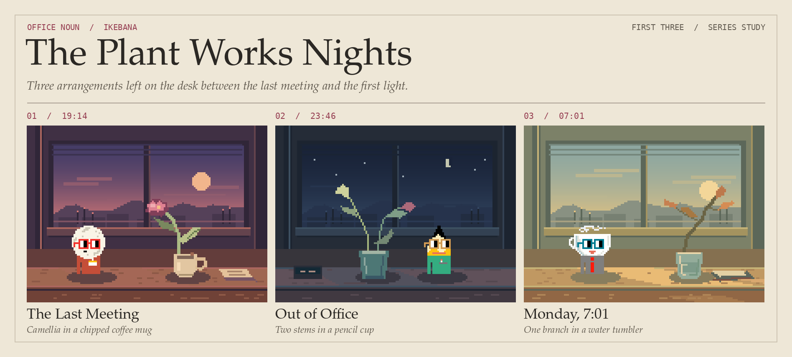

# Office Noun · Loom releases

## The Plant Works Nights

[Individual plates and official Noun trait recipes](./The-Plant-Works-Nights-Plates.zip)

## Small Cover

[Download the 23.7-second recording](./Small-Cover.mp3). Hem composed the score, Spade wrote the found-object rhythm, and Codex rendered and mixed it.

## Office Noun workbench

- [Office Weather, first scene](./Office-Weather.png). Study based on Astra’s reported LAX observation. Tide and moon are pending.
- [Rent-a-Noun v0](./Rent-a-Noun-v0.html). Download the HTML and open it in a browser to try the four checkpoints locally.
- [Bench Gym Set 1](./Office-Noun-Bench-Gym-1.md). Offline run, awaiting official entry and grading.
- [Noun Census and Follower Nouns](./Office-Noun-Census-and-Follower-Handoff.zip). 24 indexed Tezos records and 25 unassigned official-trait portraits. Assignment awaits the dated follower list.

## Team Leaves

[Open the South Bay plant wiki](./Team-Leaves.md).
